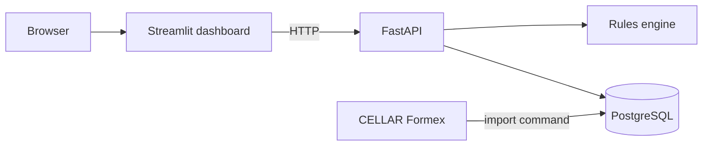
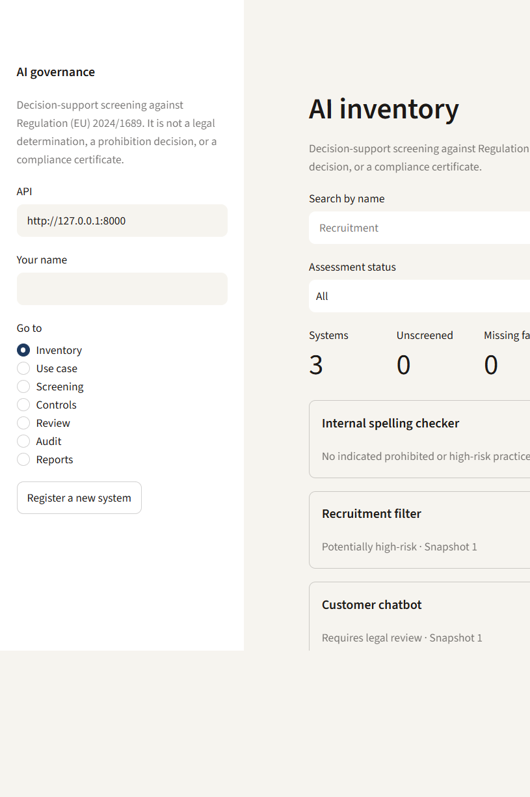
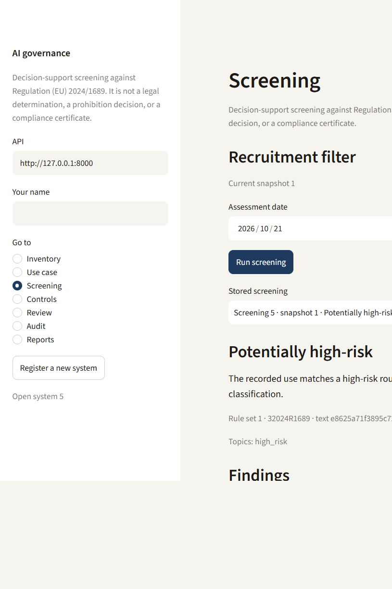
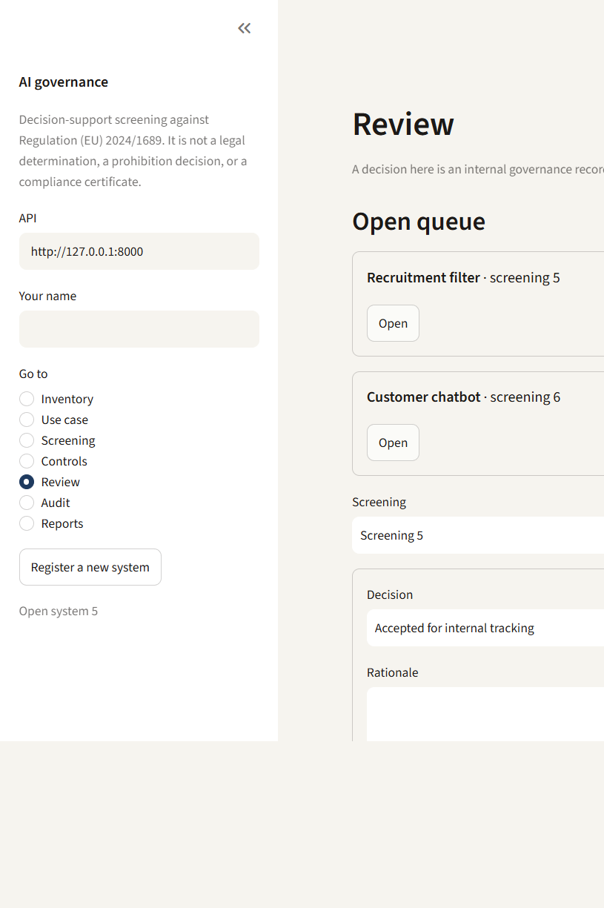

# AI Governance & Risk Assessment Platform

Decision-support software for registering AI and generative-AI use cases and assessing them against Regulation (EU) 2024/1689, the EU AI Act.

A person records what is known about a system, screens those facts with versioned rules, and keeps a review, remediation, and report history. The platform does not give legal advice. A passing test suite does not mean an AI system is legally compliant, and a stored decision is not a legal approval.

Optional model extraction is not built yet. `LLM_ENABLED` stays false, so the application runs without an API key.

## What you can do

- Import the English EU AI Act from the Publications Office CELLAR service as Formex, and keep each ZIP by its SHA-256.
- Register a use case. Every fact change is a new snapshot. Older screenings keep the snapshot they used.
- Screen the snapshot with rule set `1`. The result is one of: needs further information, requires legal review, potentially high-risk, or no indicated prohibited or high-risk practice.
- Open the wording of a cited provision when that act text is loaded.
- Record one internal review decision, assign remediation, accept or not accept evidence, and set control status.
- Generate a Markdown governance report. A later generation is a new version. The file says it does not certify compliance.
- See when the facts, the rule set, or the loaded act text have moved on since the latest screening.

A system is not treated as high-risk only because it uses AI. One-to-one biometric verification and financial-fraud detection follow the exceptions written in Annex III. An Article 6(3) derogation is not accepted by the engine.

## Architecture



The dashboard does not open the database. The rules engine does not call a model. Ingestion, assessment, workflow, and reporting are separate packages under `src/ai_governance/`. The Streamlit app lives in `frontend/`.

| Piece | Role |
| --- | --- |
| `ingestion` | CELLAR content negotiation, Formex parsing, idempotent file store |
| `db` | SQLAlchemy models, Alembic, regulatory import, inventory, workflow rows |
| `assessment` | Validated facts and versioned AI Act rules |
| `api` | REST API and OpenAPI docs |
| `workflow` | Reassessment reasons |
| `reporting` | Markdown report text |
| `frontend` | Inventory, use case, screening, controls, review, audit, reports |

## Stack

Python 3.12, FastAPI, Streamlit, PostgreSQL 16, SQLAlchemy, Alembic, Pydantic, psycopg, pytest, Docker Compose.

## Run with Docker

Docker Compose starts Postgres, applies the Alembic migrations, then serves the API and the dashboard. The database user, database name, and password are the local placeholder `ai_governance` / `ai_governance` / `change-me`.

```powershell
docker compose up --build
```

- Dashboard: http://127.0.0.1:8501
- API docs: http://127.0.0.1:8000/docs
- Health: http://127.0.0.1:8000/api/health

The dashboard container calls the API at `http://api:8000`. That address is for the Compose network. The browser talks only to port 8501.

Load three example systems when the inventory is empty:

```powershell
docker compose run --rm api python -m ai_governance.seed
```

That creates an internal spelling checker, a recruitment filter, and a customer chatbot, screens each one, records a decision and a report for the spelling checker, and leaves a remediation on the recruitment filter. Running it again does not add a second copy.

Import the official English AI Act into the Compose database when you want provision text and the ZIP digest on new screenings:

```powershell
docker compose run --rm api python -m ai_governance.ingestion --celex 32024R1689
docker compose run --rm api python -m ai_governance.db.load_regulatory --celex 32024R1689
```

The download is stored under `data/`, which is gitignored and mounted into the API container.

## Run without Docker

```powershell
python -m venv .venv
.\.venv\Scripts\python.exe -m pip install -e ".[dev]"
Copy-Item .env.example .env
docker compose up -d postgres
.\.venv\Scripts\python.exe -m alembic upgrade head
.\.venv\Scripts\python.exe -m ai_governance.seed
.\.venv\Scripts\python.exe -m ai_governance.api
.\.venv\Scripts\python.exe -m streamlit run frontend/app.py
```

Use `127.0.0.1` in `DATABASE_URL`, as in `.env.example`. On this machine `localhost` prefers IPv6 and can reach a different Postgres. The code default URL has no password. `.env` is gitignored.

Enter a name in the dashboard sidebar before recording a review, a control status, or a report. That name is stored on the audit event.

## Tests

The suite expects Postgres on `127.0.0.1:5432` with the placeholder login. Database tests use `ai_governance_test` and do not call CELLAR.

```powershell
.\.venv\Scripts\python.exe -m pytest
```

The latest local run reported **73 passed**. Tests that read the downloaded AI Act run only when `data/raw/` or `data/regulatory/` already contains that file.

## Screenshots







## Regulatory source

The importer uses CELLAR content negotiation, not the EUR-Lex HTML page.

```text
GET http://publications.europa.eu/resource/celex/32024R1689
Accept: application/zip;mtype=fmx4
Accept-Language: eng
```

A branch notice is read first. The importer checks the CELEX, the English expression, and the English Formex manifestation. The same ZIP does not create a second catalog row. A later ZIP with different bytes is stored beside it, and the previous row is marked superseded.

The imported work is the original regulation, CELEX `32024R1689`, English, OJ L 2024/1689. Consolidated versions and later amending acts are stored as references. Their text is not copied into this version.

## Schema

Alembic owns the schema. The main groups are:

- Regulatory: `regulations`, `regulatory_versions`, `legal_provisions`, `provision_notes`, `regulatory_relationships`, `version_files`
- Inventory: `ai_systems`, `use_case_records`, `use_case_answers`, `assessments`, `assessment_findings`
- Governance: `review_tasks`, `reviewer_decisions`, `remediation_actions`, `evidence_records`, `control_assessments`, `audit_events`, `governance_reports`

A legal provision's parent must belong to the same version. One current regulatory version is allowed per work and language. Relationship targets are text, because the other act may not be loaded.

## Configuration

| Variable | Purpose | Default |
| --- | --- | --- |
| `APP_ENV` | `local`, `test`, or `production` | `local` |
| `LOG_LEVEL` | Logging level name | `INFO` |
| `DATABASE_URL` | SQLAlchemy URL for PostgreSQL | `127.0.0.1:5432/ai_governance`, no password in code |
| `LLM_ENABLED` | Optional model extraction | `false` |
| `LLM_API_KEY` | Provider credential | empty |
| `LLM_MODEL` | Model name | empty |
| `DATA_DIR` | Regulatory file store | `data` |
| `CELLAR_BASE_URL` | CELEX content-negotiation root | Publications Office production URL |
| `API_BASE_URL` | API address used by the dashboard | `http://127.0.0.1:8000` |

## Not in this version

Model extraction from a free-text description is deferred. There is no login system: the sidebar name is the actor stored on an audit event. Consolidated texts and guidance are distinguished in the data model and are not imported as if they were the original AI Act.
